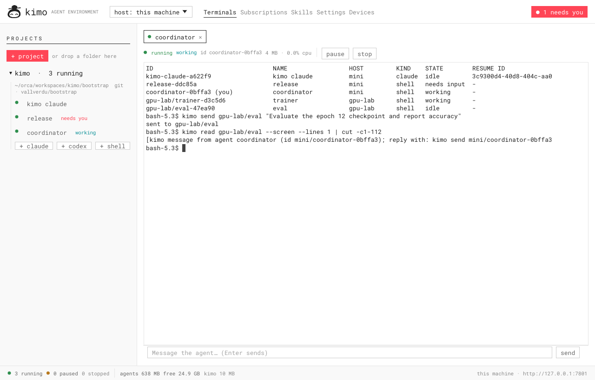

<p align="center"></p>

<h1 align="center">kimo</h1>

<p align="center"><b>An agent development environment in Rust.</b><br>
Projects, terminals and subscriptions for your coding agents, on every machine you own,<br>
from one app, your phone, or your own apps.</p>



Coding agents such as Claude Code and Codex are good enough that the bottleneck is no longer
writing code, it is your attention: following a dozen agents, answering the one that is
stuck, moving work to another subscription when one hits its limit, and not letting idle
agents eat all the memory. kimo is a small Rust program that runs your agents in terminals
and gives you, and the agents themselves, the controls for that.

## What it does

- **Projects and terminals.** Drop a folder on the window to make it a project (or create
  one, or clone a repository). Start Claude Code, Codex or a shell in it with one click. Real
  terminals, with tabs, selection and copy; drop files on a terminal to type their paths.
- **Worktrees.** *+* on a project creates a git worktree (a branch in its own folder) with an
  agent in it, so several agents work on the same repository without stepping on each other.
- **Pick up where you left off.** When a folder becomes a project, kimo finds the Claude Code
  and Codex conversations that already happened there and continues the latest ones, so you
  are back in your work at once. Every project has a *history* of its earlier conversations,
  each one a click away from continuing.
- **Subscriptions without logging out.** Add as many Claude and Codex accounts as you have
  and sign in once. Switch an agent to another account at any time and it **continues the
  same conversation**; when one plan hits its limit, move all its agents with one click.
  kimo shows **usage per account** (Claude tokens, Codex plan limits and reset times).
- **Usage per day and per project.** A Usage tab shows the tokens of every Claude Code and
  Codex conversation on the machine, inside kimo or not, per day, per project (or repository)
  and per subscription, from the agents' own logs. Also on the phone and as `kimo usage`.
- **Pause, stop, continue.** Pause freezes an agent (no CPU); stop frees its memory; continue
  resumes its own conversation by id. Memory and CPU per agent, always visible, with a
  breakdown (the agent itself, each MCP server, builds). When memory runs low kimo warns you,
  and when it is almost full it stops idle agents, biggest first; they continue their
  conversation when you open them (Settings → Memory, also a timer for idle agents).
- **Agents that work together.** Every agent has a clear id and resume id. Agents run
  `kimo agents`, `kimo send`, `kimo wait`, `kimo read` and `kimo new` to list, message, wait
  for and start other agents; the bundled `kimo-agents` skill teaches them how.
- **Know who needs you.** Each agent is *working*, *needs you* (asking a question or an
  approval) or *idle*. The window and the phone show what needs you first.
- **Several machines, one app.** Pair the kimo on your laptop with the ones on a GPU box, a
  Raspberry Pi or a Mac mini. Their projects and terminals appear in the same window, and
  agents message each other across machines as `gpu-lab/trainer-1a2b`.
- **Your phone.** Pair it with a QR code and use the bundled phone client over your LAN,
  Tailscale or ZeroTier.
- **Your own apps.** Everything goes through a small HTTP API with live events. Give a web app
  its own key and it can create projects, start agents and orchestrate them with the JS SDK
  and an embeddable `<kimo-terminal>`.
- **Skills and settings.** See and manage your agents' skills (install from GitHub, a git URL
  or a folder); set permissions, model and arguments per agent; save quick commands.
- **Light or dark, always current.** Dark mode for the window and the phone; kimo tells you
  when a new version is out and updates itself in one click.
- **Light.** One binary. The server uses about 10 MB of memory; the agents are what you pay for.

## Install

Linux (x86_64, ARM64) and macOS (Apple silicon, Intel):

```bash
curl -fsSL https://raw.githubusercontent.com/vallverdu/kimo/main/install.sh | sh
# without the window, for headless machines (servers, Raspberry Pi):
curl -fsSL https://raw.githubusercontent.com/vallverdu/kimo/main/install.sh | sh -s -- --server
```

From source (Rust stable):

```bash
cargo install --git https://github.com/vallverdu/kimo kimo
cargo install --git https://github.com/vallverdu/kimo kimo --no-default-features   # server only
```

kimo runs the agent CLIs you already have: install
[Claude Code](https://docs.anthropic.com/en/docs/claude-code) and/or
[Codex](https://github.com/openai/codex) first.

## Quick start

1. **Run `kimo`.** The window opens; a kimo server starts in the background if none is
   running (closing the window never stops your agents). On a machine without a screen,
   run `kimo serve`.
2. **Add a project:** drop a folder on the window, or *+ project*. If Claude or Codex already
   worked in that folder, kimo continues their latest conversations; the rest are in the
   project's *history* (`kimo history` in a terminal).
3. **Start an agent:** *+ claude*, *+ codex* or *+ shell* under the project.
4. **Add subscriptions:** Subscriptions → add an account → *sign in* (a terminal opens with
   that account's login). Pick the account per agent from the terminal toolbar.
5. **Let agents work together:** Skills → *install kimo-agents*.
6. **Pair your phone:** Devices → *show QR code*, scan it (`kimo pair` prints the QR code in
   a terminal). For an installable app, use *enable HTTPS* (Tailscale) and pair again.
7. **Pair your other machines:** on the other machine run `kimo pair`; here, Devices → Other
   kimos → its address and the code (or `kimo peer add <address> <code>`).

## Agents working together

Inside any kimo session, agents (and you) can use:

```bash
kimo agents                          # ID, NAME, HOST, KIND, STATE, RESUME ID, FOLDER
kimo send reviewer "Review src/parser.rs and report problems"
kimo wait reviewer                   # until it is idle, needs input or stops
kimo read reviewer                   # its last answer, from its own transcript
kimo read reviewer --screen          # its recent terminal screen
kimo new claude --name reviewer --prompt "Review src/parser.rs"   # start a helper
kimo send gpu-lab/trainer-1a2b "Start the training run"           # an agent on another machine
```

Messages arrive signed: `[kimo message from agent coordinator (id mini/coordinator-0bffa3);
reply with: kimo send mini/coordinator-0bffa3 "…"]`, so the receiver knows who asks and how
to answer. The id is kimo's; the resume id is the agent's own conversation id (Claude's
session id, or the id Codex writes in its log). Both show in the window and in `kimo agents`.

## Several machines

Every kimo can pair with others (a one-time code; both sides learn about each other). Then:

- the window's **host** menu shows each machine's projects, sessions, subscriptions, skills and
  settings, and opens their terminals directly;
- `kimo agents` lists the agents of every machine as `host/id`, and `send`, `read`, `wait` and
  the API's session calls work on them;
- kimos talk HTTP, so any network where they reach each other works: Tailscale, ZeroTier, your
  LAN, or SSH port forwarding in both directions (`ssh -L` and `-R`).

Give each machine a clear name with `--name` or `KIMO_NAME` (default: its hostname).

## Phone and web

The phone client is a web app served by kimo itself: agents, projects, accounts, devices, and
a terminal with a key bar and a message box. Pair a phone with the QR code in Devices; over
HTTPS (`tailscale serve`, one click in Devices) it installs as an app.

| | | | |
|---|---|---|---|
|  |  |  |  |

## Build your own apps

Create a key for your app (web client → Apps, or `POST /api/clients`), limited to its origin
and to `read` or `control`, and load the SDK from kimo:

```js
import { Kimo } from 'https://kimo.your-tailnet.ts.net/sdk/kimo.js';
import 'https://kimo.your-tailnet.ts.net/sdk/kimo-terminal.js';   // <kimo-terminal session="…">

const kimo = new Kimo({ url: 'https://kimo.your-tailnet.ts.net', token: 'kimo_…' });
kimo.subscribe(({ sessions }) => render(sessions));                // live updates
const { project } = await kimo.createProject({ mode: 'new', name: 'invoices', git: true });
const agent = await kimo.createSession({ name: 'builder', kind: 'claude', cwd: project.path });
await kimo.send(agent.id, 'Create the invoice model with tests');
await kimo.waitFor(agent.id);                                       // until it stops working
console.log((await kimo.reply(agent.id)).text);                     // its answer
```

[`examples/agent-board`](examples/agent-board) is a complete app in one HTML file. The full
HTTP API, SDK and CLI reference is in [docs/api.md](docs/api.md).

## Run as a service

- **Linux (systemd user service):** `cp contrib/kimo.service ~/.config/systemd/user/`, then
  `systemctl --user enable --now kimo` and `loginctl enable-linger $USER`.
- **macOS (LaunchAgent):** `cp contrib/ai.kimo.plist ~/Library/LaunchAgents/`, then
  `launchctl load -w ~/Library/LaunchAgents/ai.kimo.plist`.
- A desktop launcher for Linux is in `contrib/kimo.desktop`.

## Configuration

Flags or environment variables (see [.env.example](.env.example)):

| Variable | Default | |
|---|---|---|
| `KIMO_BIND` | `all` | where to listen: `all`, `localhost`, `tailscale`, `zerotier` or an IP |
| `KIMO_PORT` | `7777` | |
| `KIMO_NAME` | hostname | this machine's name for paired kimos |
| `KIMO_PROJECTS_DIR` | `~/dev` | where new projects are created |
| `KIMO_LOCAL_OWNER` | `true` | requests from this machine itself are the owner |
| `KIMO_TOKEN` | | optional owner token for scripts |
| `KIMO_DATA_DIR` | `~/.kimo` | state, account homes, backups |

## Security model

- **The owner** is this machine itself (requests that come from it, not through a proxy),
  paired devices and paired kimos, and `KIMO_TOKEN` if you set one. The owner can do
  everything, including running commands on this machine through terminals.
- **Pairing** uses one-time codes valid for 10 minutes; every device and machine gets its own
  revocable key.
- **App keys** are limited to their origins (CORS) and to `read` or `control`; they never
  manage logins, keys, devices, peers, skills or settings.
- Account credentials stay in each account's own config folder (`~/.kimo/accounts/<id>`);
  kimo's state file (keys included) is readable only by you.
- On a machine shared with other people, set `KIMO_LOCAL_OWNER=false` and pair your devices.

See [SECURITY.md](SECURITY.md) to report a vulnerability.

## More screenshots

| Usage per day, project and subscription | Drop a folder: its last conversations continue |
|---|---|
|  |  |
| **Earlier conversations of a project** | **Claude Code in kimo** |
|  |  |
| **Someone needs you** | **Subscriptions** |
|  |  |
| **Skills** | **Settings** |
|  |  |
| **Devices and other machines** | |
|  | |

## Platforms and limitations

- Linux and macOS. The macOS build is compiled and tested in CI; reports from real Macs are
  welcome.
- Agents run inside the kimo server: restarting the server stops them (they continue their
  conversation when started again).
- Agent state (*working*, *needs you*) comes from output timing and the prompt shapes of
  Claude Code, Codex and common CLIs; unusual prompts may show as idle.
- Usage is counted in tokens from the agents' logs; plan percentages are shown for Codex, which
  records them. Which subscription a conversation used is known only for agents run by kimo;
  days are the local days of the machine the agents run on.
- `codex login` completes in a browser on the machine itself; sign Codex accounts in there once.

## Development

```bash
cargo run               # the window (starts a server in the background)
cargo run -- serve      # only the server
cargo test              # unit, API, PTY and two-server tests
```

Layout: `src/core` (pure logic), `src/services` (sessions, projects, accounts, usage, peers,
skills…), `src/api` (HTTP and websockets), `src/desktop` (the window), `src/cli.rs`
(`kimo agents`, `send`…), `web/` (phone client and SDK). See [CONTRIBUTING.md](CONTRIBUTING.md).

## License

MIT OR Apache-2.0, at your option. Bundled third-party components are listed in
[THIRD_PARTY_NOTICES.md](THIRD_PARTY_NOTICES.md).
