# kimo

A small, mobile-first **agent development environment** written in Rust. One 4 MB binary runs
on your server and is the control center for your coding agents: projects, terminals with
Claude Code, Codex or a shell, subscriptions you switch without logging out, and memory/CPU per
agent. Use it on the server's own screen, then **pair your phone with a QR code** and use it
from any device on your network (LAN, Tailscale, ZeroTier).

kimo is meant to be the **agent backend for all your PWAs**: Everpano, a project manager or any
other app can watch and drive the same agents with its own key, through a small JS SDK and an
embeddable `<kimo-terminal>`. kimo's own interface is just the first of those apps.

It exists because attention is the bottleneck: you should be able to follow, pause, move and
continue dozens of agents from a phone, without logging out and in when a subscription runs
out, and without 26 idle agents eating 30 GB of RAM.

## Screenshots

### On the server: projects and pairing a phone

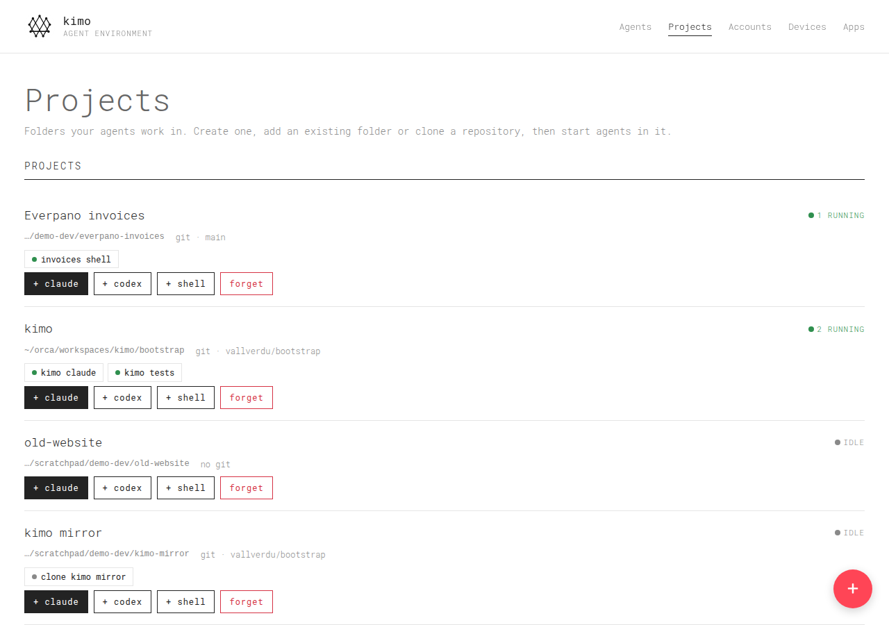

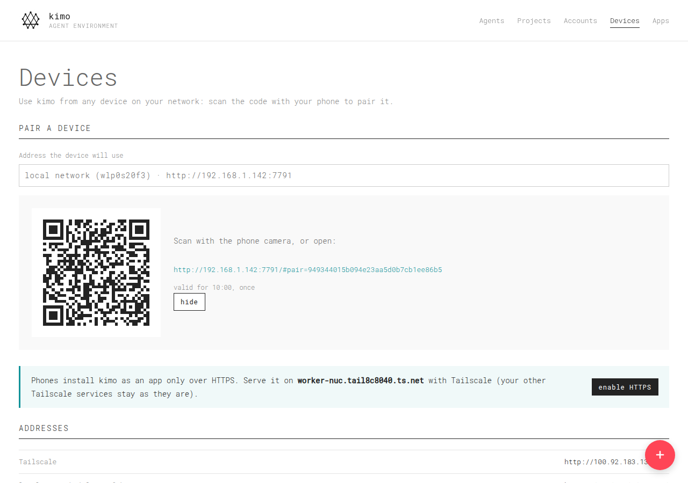

| Scan → pair | Projects on the phone | New project | Folder picker |
|---|---|---|---|
| 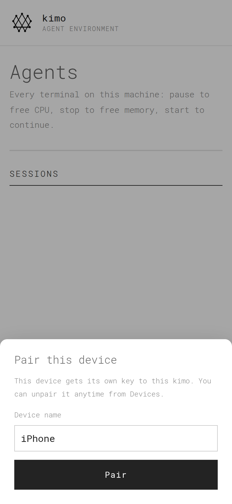 |  | 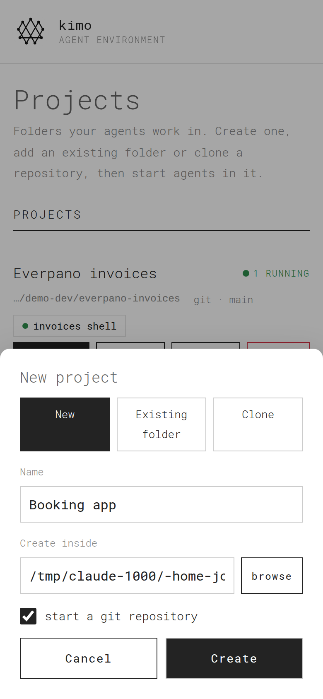 | 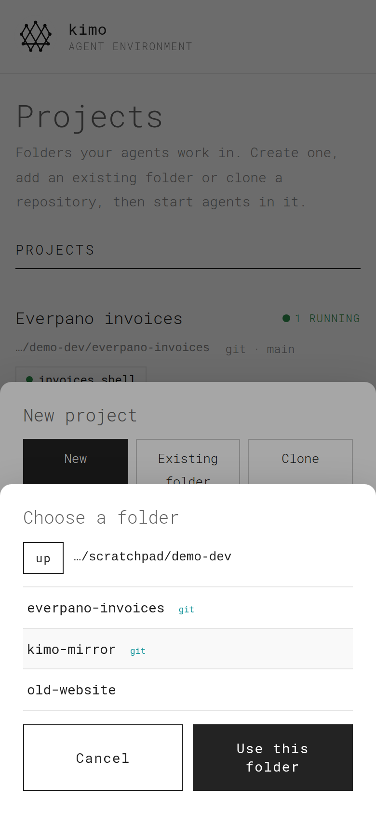 |

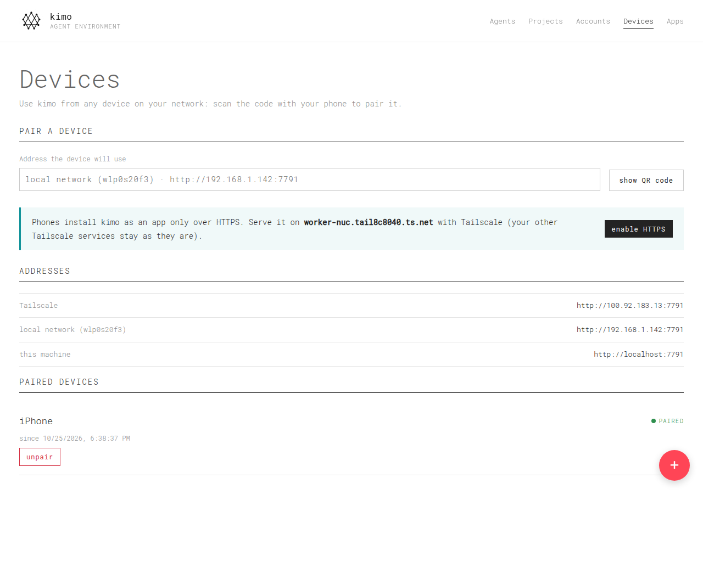

### Agents

Real run on a laptop: a Claude Code agent (≈650 MB, the reason stopping matters), two shells,
one paused, one stopped; kimo itself uses 6 MB.

| Agents | Every session | Claude Code in a terminal |
|---|---|---|
|  | 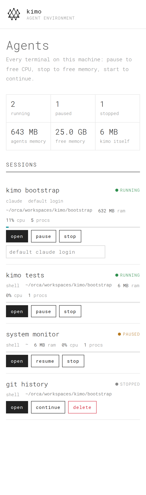 |  |

| Paused session | Accounts | New session |
|---|---|---|
| 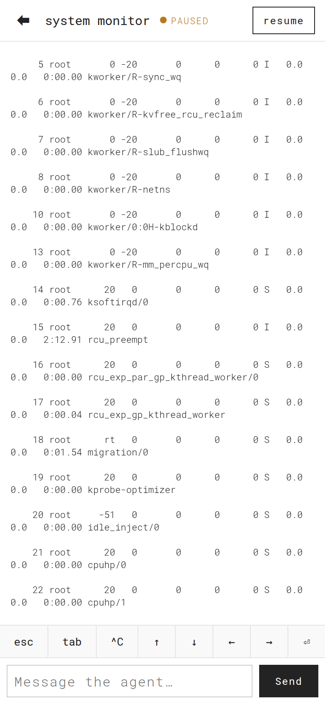 |  | 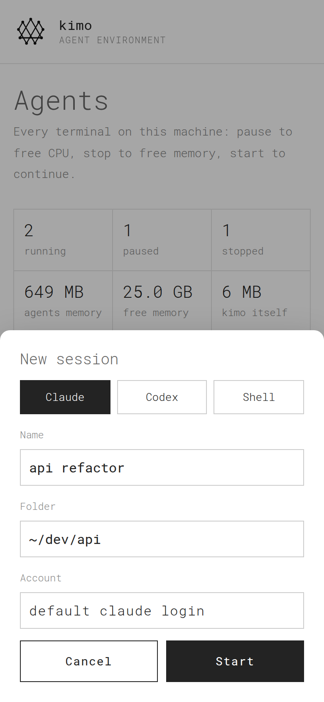 |

A session is *paused* (frozen with SIGSTOP, no CPU, memory kept) or *stopped* (memory freed,
**continue** brings the conversation back). The terminal has a key bar and a compose box so an
agent can be driven without a keyboard.

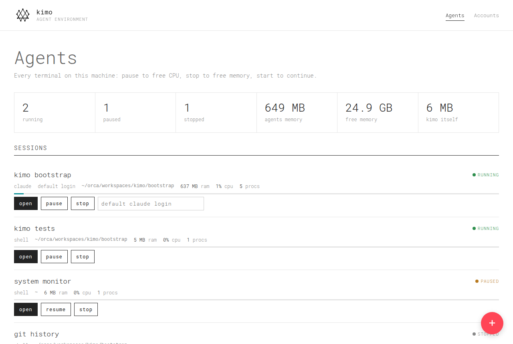

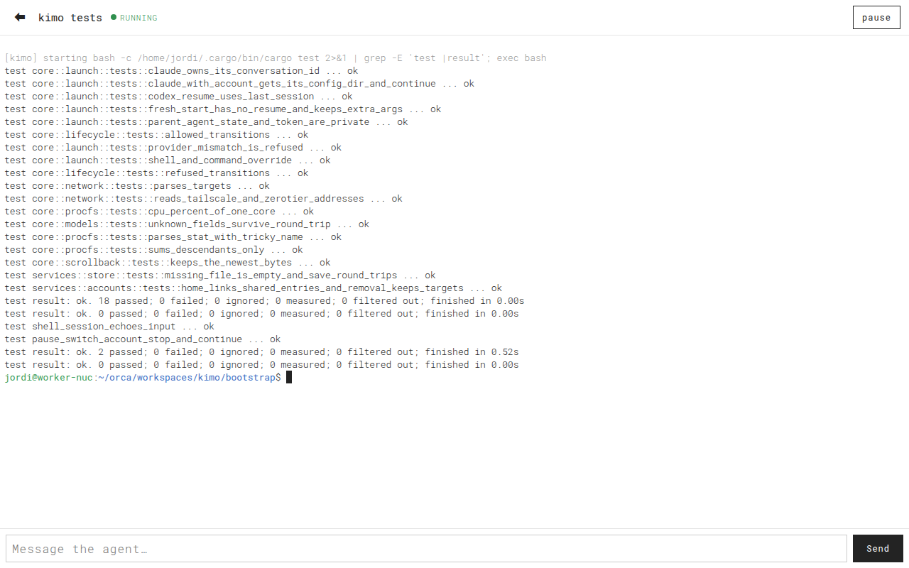

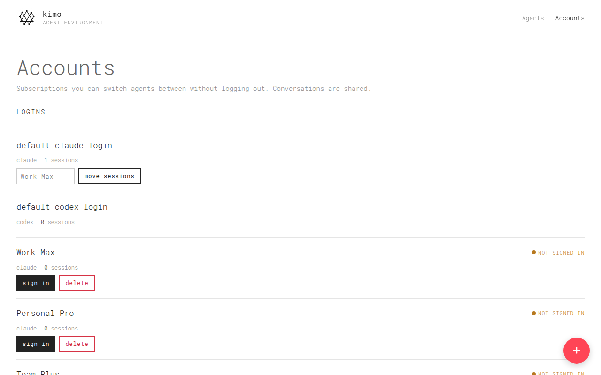

## What it does

- **Projects**: create a project folder (optionally `git init`), add an existing folder with
  a folder picker, or clone a repository (the clone runs in a terminal you can watch). Each
  project shows its git branch and its agents, with **+ claude / + codex / + shell** to start one
  there. Forgetting a project never deletes files.
- **Terminals**: Claude, Codex or shell sessions in any folder; full screen with a phone key bar
  (esc, tab, ^C, arrows) and a compose box for typing messages.
- **Pause / stop / continue**: *pause* freezes the whole process tree (SIGSTOP: no CPU, memory
  kept); *stop* ends it to free the memory; *continue* brings the conversation back. Each Claude
  session owns its conversation id (`--session-id`, then `--resume <id>`), so agents sharing a
  folder never pick up each other's conversation; Codex uses `codex resume --last`.
- **Accounts without logout**: each account gets its own config home
  (`~/.kimo/accounts/<id>`, via `CLAUDE_CONFIG_DIR` / `CODEX_HOME`); sign in once per account.
  Every account home links the default home's conversations and settings (`projects/`,
  `settings.json`, `skills/`… for Claude; `sessions/`, `config.toml`… for Codex), so moving a
  session to another account restarts it under the new subscription *and continues the same
  conversation*. Hit a limit? Accounts → **move sessions** moves all of them at once.
- **Resources**: memory, CPU and process count per session (whole process tree, from `/proc`),
  machine free memory and kimo's own footprint (~5 MB RSS); a warning when memory runs low.
- **Every device on your network**: kimo listens on all networks and lists its addresses (LAN,
  Tailscale IP and HTTPS name, ZeroTier). The server's own screen is the owner, no login. Other
  devices **pair with a QR code** (Devices tab, or `kimo pair` in a terminal): a one-time code,
  valid 10 minutes, becomes that device's own key; unpair it anytime. One tap serves kimo over
  HTTPS on your tailnet (`tailscale serve`, on a free port: other services stay as they are), so
  phones can install it as an app.
- **Clean environment**: sessions do not inherit kimo's token or the state of a parent agent
  session (`CLAUDECODE`, `CLAUDE_CODE_*`), so kimo can itself be started from an agent.
- **A backend for your other PWAs**: per-app keys bound to the app's origin and to a scope
  (read or control), CORS, a live event stream and a JS SDK served by kimo (below).

## Run

Needs Linux and Rust (`curl https://sh.rustup.rs -sSf | sh`).

```bash
cargo run --release      # prints its addresses; open http://localhost:7777 on the server
cargo test               # unit, API and PTY integration tests
```

1. **On the server** open `http://localhost:7777`: you are the owner, nothing to log in.
2. **Pair your phone**: Devices → *show QR code* → scan it with the phone camera → *Pair*.
   On a server without a screen run `kimo pair` instead: it prints the QR code in the terminal.
3. **Install it as an app** (optional): Devices → *enable HTTPS* (Tailscale), pair again using
   the HTTPS address and choose "Add to home screen". Browsers only install apps over HTTPS.

**Run it as a service** so it starts with the machine:

```bash
cargo install --path .
mkdir -p ~/.config/systemd/user && cp contrib/kimo.service ~/.config/systemd/user/
systemctl --user daemon-reload && systemctl --user enable --now kimo
loginctl enable-linger $USER     # keep running when you are logged out
```

Settings come from flags or the environment (`.env.example`): `KIMO_BIND` (default `all`; or
`tailscale`, `zerotier`, `localhost`, an IP), `KIMO_PORT`, `KIMO_PROJECTS_DIR` (default `~/dev`),
`KIMO_LOCAL_OWNER` (set `false` on machines shared with other users), `KIMO_TOKEN` (optional
owner token for scripts), `KIMO_DATA_DIR`, `KIMO_SCROLLBACK`, `KIMO_ORIGINS`.

**Add an account:** Accounts → + → name and provider → **sign in** (opens a terminal running
`claude auth login` / `codex login` with that account's config home). Then pick the account
when creating a session, or switch it from the session row.

## Connect your PWAs

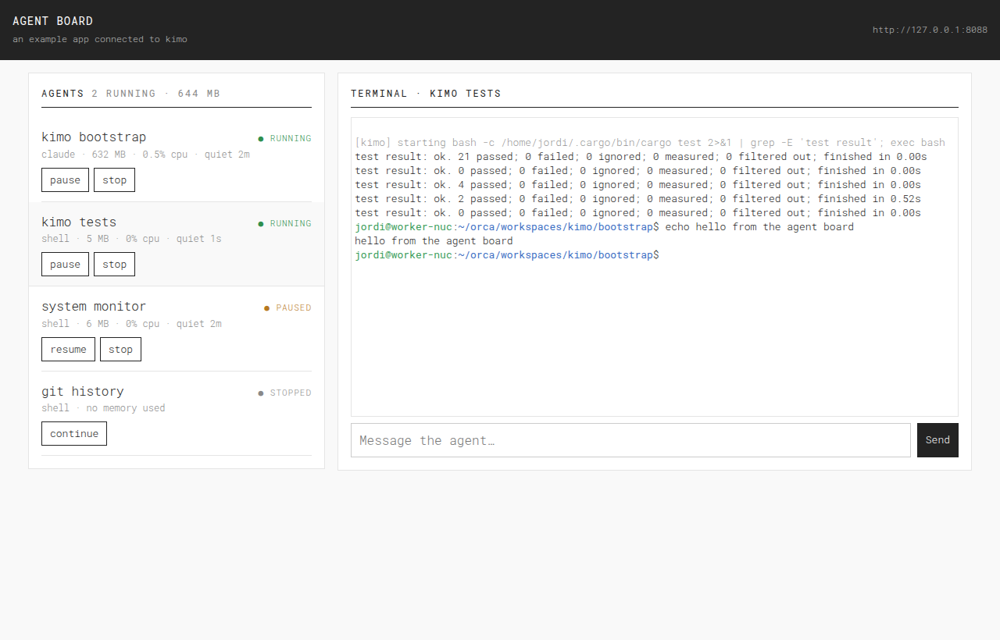

1. **Give the app a key.** kimo → **Apps** → **+**: name, the app's origin (e.g.
   `https://pm.your-tailnet.ts.net`) and a scope: **control** (start, pause, stop, switch accounts,
   type, open terminals) or **read** (watch only). The key is shown once; revoke it anytime.
   Logins and keys themselves stay with the owner token.
2. **Load the SDK from kimo** and use the key:

```js
import { Kimo, quietFor } from 'https://kimo.your-tailnet.ts.net/sdk/kimo.js';
import 'https://kimo.your-tailnet.ts.net/sdk/kimo-terminal.js';   // defines <kimo-terminal>

const kimo = new Kimo({ url: 'https://kimo.your-tailnet.ts.net', token: 'kimo_…' });

kimo.subscribe(({ sessions, accounts }) => render(sessions));      // live, no polling
await kimo.createSession({ name: 'invoices', kind: 'claude', cwd: '~/dev/everpano' });
await kimo.send(id, 'run the tests and fix what fails');           // message an agent
await kimo.pause(id); await kimo.stop(id); await kimo.start(id);    // start = continue
await kimo.moveSessions('work-max', 'personal-pro');                 // subscription limit hit
quietFor(session);                                                   // seconds since last output

const term = document.querySelector('kimo-terminal');               // <kimo-terminal session="…">
term.kimo = kimo; term.setAttribute('session', id); term.send('/compact\r');
```

A key only works from the origins it lists, so a leaked key cannot be used from another
website, and no website can reach kimo without a key, even on localhost. Pages on HTTPS must reach
kimo over HTTPS too (`tailscale serve`). A complete example app, one static file, is in
[`examples/agent-board`](examples/agent-board): its own origin, its own look, live list,
pause/stop/continue, embedded terminal and message box.

| Agent board on a phone | Apps tab | New key |
|---|---|---|
| 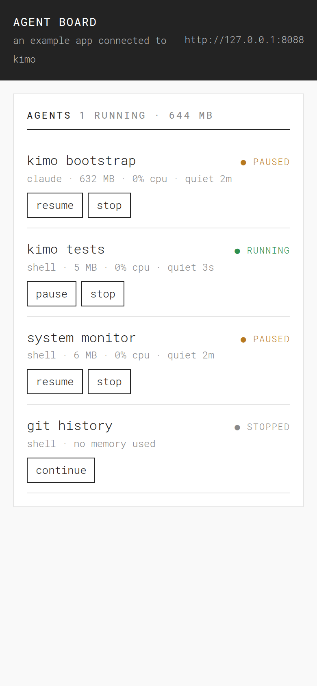 | 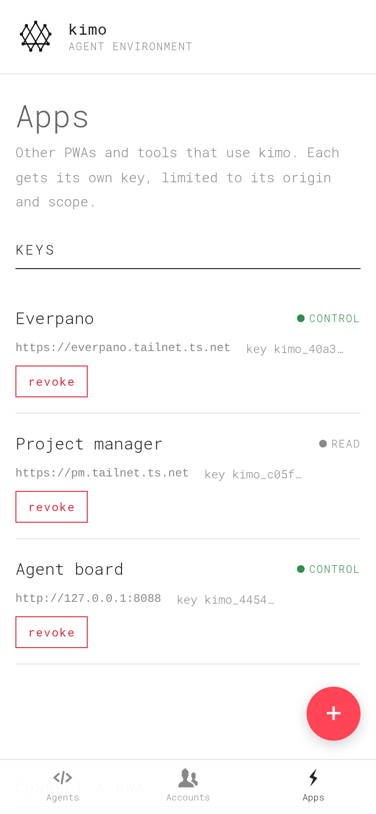 | 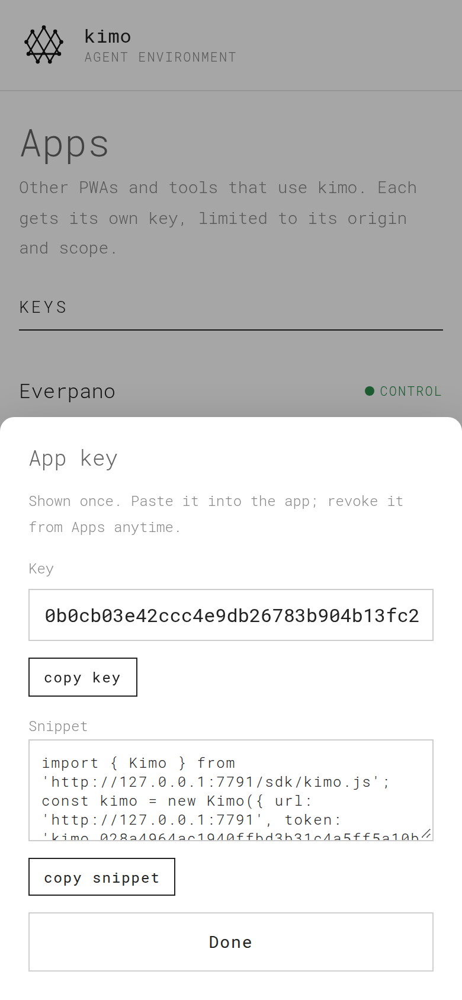 |

## API

All under `/api`, JSON, `Authorization: Bearer <key>` (or `?token=` for websockets and
EventSource). The owner (the server itself, paired devices, `KIMO_TOKEN`) may do everything;
app keys are limited by scope and origin.

| Method | Path | |
|---|---|---|
| GET | `/status` | memory, kimo RSS, counts |
| GET (SSE) | `/events` | `update` events with `{sessions, accounts}` on every change |
| GET, POST | `/sessions` | list; create `{name, kind: claude\|codex\|shell, cwd, account?, args?, command?, start?}` |
| GET, DELETE | `/sessions/{id}` | one session; delete (stops it first) |
| POST | `/sessions/{id}/action` | `{action: start\|pause\|resume\|stop\|restart}` |
| POST | `/sessions/{id}/account` | `{account: id\|null}`: switch subscription, continues the conversation |
| POST | `/sessions/{id}/input` | `{text}`: type into the terminal |
| GET (ws) | `/sessions/{id}/term` | terminal: binary frames both ways, text `{"type":"resize","cols","rows"}` |
| GET, POST | `/accounts` | list (with `signed_in`); create `{name, provider}` |
| DELETE | `/accounts/{id}` | delete (refused while sessions use it) |
| POST | `/accounts/{id}/login` | start a sign-in terminal |
| POST | `/accounts/{id}/move` | `{to: id\|null}`: move all its sessions (`default` = default login) |
| GET, POST | `/clients` | owner only: list app keys (no secrets); create `{name, origins, scope: read\|control}` → key |
| DELETE | `/clients/{id}` | owner only: revoke an app key |
| GET, POST | `/projects` | list (branch, session counts); create `{mode: new\|existing\|clone, name?, path?, git?, url?}` |
| DELETE | `/projects/{id}` | forget a project (files stay) |
| GET | `/fs?path=` | subfolders, for folder pickers (control keys and owner) |
| GET | `/network` | owner: addresses kimo is reachable on, Tailscale name and HTTPS URL |
| POST | `/network/https` | owner: serve kimo over HTTPS on the tailnet |
| POST | `/pairing` | owner: one-time pairing code (10 min) |
| POST | `/pair` | `{code, name}` → the new device's key (no key needed, the code is the proof) |
| GET, DELETE | `/devices`, `/devices/{id}` | owner: paired devices; unpair |
| GET | `/qr?text=` | owner: QR code as SVG |

Sessions carry `status`, `usage {rss_bytes, cpu_percent, processes}`, `last_output_at` (unix ms),
`account`, `kind`, `cwd`. SDK: `/sdk/kimo.js`, `/sdk/kimo-terminal.js` (loadable from any origin).

## Layout

```
src/main.rs            entry: flags/env → manager → HTTP server; `kimo pair`
src/api/               axum routes, websocket terminal, auth (owner, devices, app keys), embedded PWA
src/services/          sessions (PTYs, lifecycle, switching), projects, devices (pairing), accounts, store, stats, network
src/core/              pure logic: models, access rules, lifecycle, launch commands, git HEAD, /proc and network parsing, scrollback
contrib/kimo.service   systemd user unit
web/                   kimo's PWA (web-timber style, xterm.js vendored), embedded in the binary on release
web/sdk/               the SDK other PWAs load from kimo: kimo.js (API + events), kimo-terminal.js
examples/agent-board/  a separate example app using only the SDK and an app key
tests/                 PTY integration tests with a fake `claude`; API access tests (CORS, keys, scopes, events)
```

## Limitations

- Codex sessions resume the folder's *last* Codex conversation (Codex has no way to set the
  id up front): avoid two Codex sessions in the same folder for now.
- Linux only for now (`/proc`, process groups).
- Sessions live inside the kimo process: stopping kimo stops the agents (they continue with
  *continue* afterwards). A detachable session holder is on the TODO list.
- `codex login` signs in through a browser callback on the machine itself; from a phone, sign
  Codex accounts in once at the computer or with `codex login --with-api-key`.
- "The server is the owner" trusts every request from the machine itself (not through a
  proxy). On a machine shared with other Unix users, run with `KIMO_LOCAL_OWNER=false` and pair
  devices with `KIMO_TOKEN` instead.
- The web layer uses the commercial Timber theme: keep the repository private.
